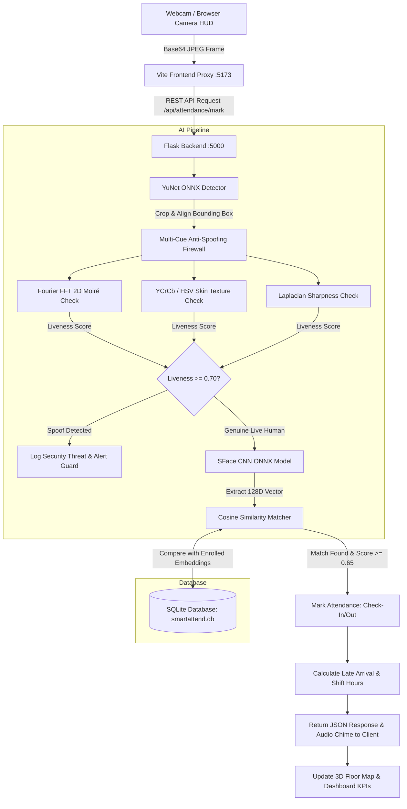

# SmartAttend 3D – Complete Project & Viva Voce Guide
> **Document Purpose:** Complete guide explaining the Technology Stack, Architecture, Working Principles, Live Demonstration Steps, and Examiner/Teacher Q&A (Viva Voce) for **SmartAttend 3D**.  
> **Official University Report:** See [PROJECT_REPORT.md](file:///c:/Users/lenovo/Desktop/Project/PROJECT_REPORT.md) formatted per Chandigarh University guidelines with designated screenshot placement frames.

---

## 📑 Table of Contents
1. [Executive Summary (The 60-Second Elevator Pitch)](#1-executive-summary-the-60-second-elevator-pitch)
2. [Problem Statement & Why Existing Systems Fail](#2-problem-statement--why-existing-systems-fail)
3. [Technology Stack: What Was Used & Why](#3-technology-stack-what-was-used--why)
4. [System Architecture & Data Flow](#4-system-architecture--data-flow)
5. [Core Modules & What the Application Does](#5-core-modules--what-the-application-does)
6. [Deep Dive: How the AI & Anti-Spoofing Engine Works](#6-deep-dive-how-the-ai--anti-spoofing-engine-works)
7. [Step-by-Step Teacher Demonstration Guide](#7-step-by-step-teacher-demonstration-guide)
8. [Teacher & Examiner Viva Questions & Answers (FAQ)](#8-teacher--examiner-viva-questions--answers-faq)

---

## 1. Executive Summary (The 60-Second Elevator Pitch)

> **Say this to your teacher when starting:**
> *"Good morning/afternoon, Sir/Ma'am. My project is **SmartAttend 3D**, an enterprise-grade AI-powered biometric attendance and workplace security platform.*
>
> *Traditional attendance systems suffer from **buddy punching**, **RFID card sharing**, or **vulnerability to photo and mobile screen spoofing**. SmartAttend 3D solves this by combining **deep learning face recognition** using the SFace CNN architecture, a **multi-cue anti-spoofing firewall** that uses Fourier transform frequency analysis to catch fake screen replays and printed photos, and an **interactive 3D Digital Twin command center** built in Three.js and React.*
>
> *It features real-time 1-second verification, role-based access control for Admins, Security Officers, and Employees, live office floor occupancy tracking, and zero-trust security incident auditing."*

---

## 2. Problem Statement & Why Existing Systems Fail

| Traditional Method | Critical Vulnerability | How SmartAttend 3D Solves It |
| :--- | :--- | :--- |
| **Paper Logbooks / Registers** | Easily falsified, manual entry errors, no audit trail. | Automated timestamping, cryptographic biometric signature. |
| **RFID / Magnetic Cards** | "Buddy punching" — one employee swipes in for an absent colleague. | Biometrics tied strictly to the physical person's face vector. |
| **Fingerprint Scanners** | Physical contact required (hygiene risk), sensor wears out, latency. | 100% contactless WebRTC camera scanning in < 1 second. |
| **Basic Webcam Face Apps** | Fooled by holding up an iPhone photo, printed picture, or video replay. | **Multi-Spectral Anti-Spoofing Firewall** (Fourier frequency domain + YCrCb skin texture analysis). |
| **2D Flat Dashboards** | Hard to visualize large office layouts and floor occupancy status. | **Interactive 3D Digital Twin** showing spatial status (Present, Late, Absent). |

---

## 3. Technology Stack: What Was Used & Why

### 🎨 Frontend Tier
* **React 18 + Vite**:
  * *Why:* Ultra-fast hot module reloading (Vite), component modularity, high rendering performance for real-time camera updates.
* **Three.js & React Three Fiber (`@react-three/fiber`, `@react-three/drei`)**:
  * *Why:* Powers the 3D Command Center — renders the 3D Cyber Security Shield, interactive 3D Workplace Floor Map, and 3D Analytics Trend Chart directly inside the browser using WebGL without external plugins.
* **Tailwind CSS & Glassmorphism Design System**:
  * *Why:* Creates an ultra-modern, dark cybernetic enterprise interface with consistent color tokens, backdrop filters, and responsive layouts.
* **Lucide React & Framer Motion**:
  * *Why:* Smooth micro-animations, page transitions, and clean enterprise iconography.
* **Recharts & Canvas Confetti**:
  * *Why:* Interactive 2D data visualizations (punctuality trends, department metrics) and delightful UI feedback on successful check-in.

### ⚙️ Backend Tier
* **Python 3 & Flask**:
  * *Why:* Python is the industry standard for Computer Vision and AI. Flask provides a lightweight, asynchronous-friendly REST API architecture without the heavy overhead of Django.
* **Flask-CORS & PyJWT**:
  * *Why:* Secure Cross-Origin Resource Sharing with the Vite frontend; PyJWT manages stateless JSON Web Tokens with encrypted payloads for Role-Based Access Control (RBAC).
* **Werkzeug & Bcrypt**:
  * *Why:* Secure password hashing with salt rounds, mitigating brute-force and dictionary attacks.

### 🧠 AI & Computer Vision Core
* **OpenCV (`opencv-python-headless`)**:
  * *Why:* High-performance image matrix manipulation, color space conversion, and image Fourier transforms.
* **YuNet Face Detector (`face_detection_yunet_2023mar.onnx`)**:
  * *Why:* State-of-the-art deep learning face detector. Much faster and far more accurate across extreme angles, occlusions, and lighting variations than legacy Haar Cascades.
* **SFace Deep CNN (`face_recognition_sface_2021dec.onnx`)**:
  * *Why:* Deep neural network trained for facial feature representation. Extracts a compact, discriminative **128-dimensional L2-normalized floating point vector** per face.
* **NumPy**:
  * *Why:* Accelerated vector arithmetic — calculates **Cosine Similarity** between live camera embeddings and stored database vectors in under 2 milliseconds.
* **Fast Fourier Transform (FFT - 2D)**:
  * *Why:* Converts spatial pixel domain into frequency spectrum to detect high-frequency Moiré patterns typical of LCD/OLED screens.

### 🗄️ Database Tier
* **SQLite3 (Relational Architecture)**:
  * *Why:* Zero-configuration, zero-latency serverless relational engine storing employees, attendance logs, 128D biometric vectors (as serialized JSON arrays), and security breach events.
  * *Scalability Note:* Designed with strict foreign keys and standard SQL datatypes, allowing seamless migration to **PostgreSQL** or **MySQL** in high-concurrency production environments.

---

## 4. System Architecture & Data Flow

---

## 5. Core Modules & What the Application Does

### 1. 🛡️ AI Anti-Spoofing & Biometric Verification
- Scans live faces via webcam in real-time.
- Ensures the face is a **living, breathing human** before attempting identification.
- Rejects printed photographs, mobile screens, iPads, and recorded video playback.

### 2. 🌐 Interactive 3D Digital Twin Command Center
- Built using Three.js and React Three Fiber.
- **3D Hero Security Shield**: Displays system status and AI operational readiness.
- **3D Floor Map**: Visual isometric floor model with glowing beacons indicating employee status:
  - 🟢 **Green**: Present and verified.
  - 🟡 **Amber**: Late arrival.
  - 🔴 **Rose**: Absent / Not checked in.
- **3D Analytics Visualizer**: 3D interactive bars showing attendance distributions.

### 3. 🏢 Enterprise Workforce Governance
- **Automated Check-in / Check-out**: Supports 1 check-in per day per employee with live shift duration calculation.
- **Punctuality Intelligence**: Flags arrivals past department shift time + grace period (e.g., 09:00 AM + 15 min grace = Late at 09:16 AM).
- **Employee Directory**: Allows enrolling new employees, uploading/capturing profile photos, and managing departments.

### 4. 🚨 Zero-Trust Security Incident Center
- Logs any failed liveness attempts as a security event with snapshot capture, attack vector type (e.g. *Mobile Screen*, *Printed Paper*), confidence score, and timestamp.
- Allows security personnel to review, investigate, or resolve threats.

### 5. 📊 Reports, Analytics & Exports
- Punctuality graphs, department attendance breakdowns, and attendance rate percentages.
- **1-Click CSV Export** for payroll integration and printable PDF audit statements.

### 6. 🔐 Role-Based Access Control (RBAC)
- **Admin**: Full control (workforce enrollment, system settings, AI threshold adjustments, reports).
- **Security Officer**: Access to the live camera scanner, security incident log, and attendance records.
- **Employee**: Self-service portal showing personal attendance history, hours worked, and digital ID card.

---

## 6. Deep Dive: How the AI & Anti-Spoofing Engine Works

### Step A: Face Localization (YuNet ONNX)
- Standard Haar cascades fail when a face is tilted, partially in shadow, or wearing glasses.
- We use **YuNet**, an edge-optimized Convolutional Neural Network that outputs:
  1. Bounding box coordinates `[x, y, width, height]`.
  2. Five facial landmarks: left eye, right eye, nose tip, left mouth corner, right mouth corner.
  3. Detection confidence score.

### Step B: The Multi-Cue Anti-Spoofing Firewall
Before recognizing *who* the person is, the system proves *what* is in front of the lens:

1. **2D Fast Fourier Transform (FFT) Frequency Analysis**:
   - Digital displays (smartphones, computer monitors) emit periodic pixel grid frequencies that cause **Moiré interference patterns**.
   - The engine computes `np.fft.fft2` on the normalized face region and masks low frequencies to compute the **high-frequency energy ratio**.
   - If energy exceeds `0.85`, it flags a **digital screen pixel grid attack**.
2. **Color Texture & Chrominance Descriptors (YCrCb & HSV)**:
   - Genuine human skin has dynamic subsurface light scattering due to subcutaneous hemoglobin (blood vessels).
   - In contrast, paper printouts and phone screens have compressed color gamuts and abnormal chrominance standard deviations ($\sigma_{Cr}, \sigma_{Cb}$).
3. **Laplacian Edge Distribution & Sharpness**:
   - Computes `cv2.Laplacian` to identify unnatural synthetic blurs (from cheap paper prints) or hyper-sharp halftone printing artifacts.
4. **Composite Liveness Score**:
   - Weighted blend: `Score = (0.45 * Fourier) + (0.35 * ColorTexture) + (0.20 * Sharpness)`.
   - If `Score >= 0.70`, the face passes the firewall.

### Step C: Biometric Feature Extraction (SFace CNN)
- The detected face is normalized, aligned using eye landmarks, and passed to the **SFace** deep convolutional network.
- SFace outputs an **embedding vector of 128 floating-point numbers** ($v \in \mathbb{R}^{128}$).
- The vector is L2-normalized: $\|v\|_2 = 1.0$.

### Step D: Cosine Similarity Matching
- To recognize the employee, the engine calculates the **Cosine Similarity** between the live embedding $u$ and stored database embeddings $v$:
$$\text{Cosine Similarity} = \frac{u \cdot v}{\|u\|_2 \|v\|_2} = \sum_{i=1}^{128} u_i \cdot v_i$$
- Since both vectors are L2-normalized, this is simply the dot product.
- If the maximum similarity exceeds `0.65` (configurable in settings), the employee is positively identified.

---

## 7. Step-by-Step Teacher Demonstration Guide

Follow this exact sequence during your live presentation:

### Step 1: Open the Application & Show the Login Page
- **URL**: `http://localhost:5173`
- **What to say**:
  > *"Here is the SmartAttend 3D portal. Notice the futuristic rotating 3D Security Shield in the login card. The system features JWT-based role authentication with three distinct roles: Chief Admin, Security Officer, and Enrolled Employee. I will click the 1-click demo button for **Chief Administrator** and log in."*

### Step 2: Showcase the 3D Command Dashboard
- **URL**: `http://localhost:5173/dashboard`
- **What to say**:
  > *"Upon logging in, the Admin lands on the 3D Command Center. Here we see real-time KPIs: Today's Attendance Rate, Present Count, Late Arrivals, and Spoof Attempts Blocked.*
  > *In the center is our **3D Digital Twin Workplace Floor Map** rendered using Three.js and WebGL. I can click and drag to orbit in 3D, zoom in, and inspect employee desk beacons. Green represents present employees, yellow represents late arrivals, and red indicates absences."*

### Step 3: Demonstrate Live Attendance Marking (The "Hero" Feature)
- **Navigation**: Click **"Mark Attendance"** on the sidebar.
- **What to say**:
  > *"This is the Smart Scanner Terminal. It connects directly to the camera feed using WebRTC.*
  > *When a face is presented to the camera HUD, our backend runs YuNet face detection and immediately executes our Multi-Cue Anti-Spoofing firewall.*
  > *If the face passes the liveness threshold, SFace extracts the 128-dimensional biometric vector, matches it against our SQLite database in under 2 milliseconds, logs the attendance with timestamp and status, and plays an affirmative audio chime."*
- **Action**: Click **"Simulate Check-In"** or position your face in the camera to demonstrate instant recognition, confetti animation, and attendance confirmation!

### Step 4: Show the Workforce Management Page
- **Navigation**: Click **"Employees"** on the sidebar.
- **What to say**:
  > *"In the Employees tab, administrators can manage the entire workforce. We can search by name, filter by department (Engineering, Design, Security, HR), enroll a new employee, and capture or register face biometric signatures directly."*

### Step 5: Show Attendance Records & Filtering
- **Navigation**: Click **"Records"** on the sidebar.
- **What to say**:
  > *"All check-ins and check-outs are recorded here with exact time, confidence score, liveness score, and punctuality status (Present vs. Late). Notice that late arrivals are automatically calculated based on the employee's shift start time plus the grace period."*

### Step 6: Show the Security Threat Log
- **Navigation**: Click **"Security"** on the sidebar.
- **What to say**:
  > *"This is our Anti-Spoofing Security Log. Whenever an unauthorized person or a spoof attack (such as a mobile screen replay or printed paper photo) is presented, the anti-spoof firewall blocks it and creates an audit record with snapshot, attack vector classification, and threat severity."*

### Step 7: Show Reports & 1-Click Export
- **Navigation**: Click **"Reports"** on the sidebar.
- **What to say**:
  > *"Administrators can view attendance summaries, department breakdown charts, and download complete CSV audit reports for enterprise payroll systems."*

---

## 8. Teacher & Examiner Viva Questions & Answers (FAQ)

Here are the top 15 questions teachers and external examiners ask during viva voce, along with the exact technical answers:

### Q1: Why did you use SFace and YuNet instead of Haar Cascades or the `face_recognition` library?
> **Answer:**
> *"Haar Cascades were invented in 2001; they rely on hand-crafted contrast features and frequently fail with tilted faces, shadows, or facial hair. The popular `face_recognition` library relies on dlib, which is heavy to compile on Windows and slower on CPU.*
> *We chose **YuNet** because it is a modern, lightweight convolutional neural network specifically optimized in OpenCV DNN for edge inference in real time. For recognition, **SFace** produces highly compact 128D embeddings with state-of-the-art accuracy, running in just a few milliseconds on standard hardware without needing an expensive GPU."*

### Q2: What is the difference between Face Recognition and Liveness Detection (Anti-Spoofing)?
> **Answer:**
> *"**Face Recognition** answers the question: *'Whose face is this?'* by matching biometric embeddings.*
> ***Liveness Detection** answers a prior, more critical question: *'Is this a real, living human physically present in front of the camera, or is it an artifact like a photo or screen replay?'*
> Without anti-spoofing, any face recognition system can be easily hacked with a photo from social media."*

### Q3: How does your system detect spoofing from a smartphone screen?
> **Answer:**
> *"Smartphones and monitors display images using RGB subpixel grids that emit light with distinct periodic frequencies. When captured by a webcam, this creates **Moiré interference**.*
> *Our engine applies a **2D Fast Fourier Transform (FFT)** to the facial region, converting spatial pixels into the frequency domain. Digital screens exhibit unnatural spikes in high-frequency energy compared to natural skin. If the high-frequency energy ratio exceeds 0.85, the system identifies a digital screen replay attack."*

### Q4: How does Cosine Similarity work for face verification?
> **Answer:**
> *"The SFace model maps facial features into a 128-dimensional hypersphere where each vector has unit length ($L_2 = 1.0$).*
> *Cosine similarity measures the cosine of the angle between two vectors: $\cos(\theta) = \frac{A \cdot B}{\|A\|\|B\|}$.*
> *If two images belong to the same person, their feature vectors point in almost the same direction ($\cos(\theta) \approx 1.0$). If they are different people, the angle is large. We use a threshold of 0.65 for positive identification."*

### Q5: Why did you use Three.js and React Three Fiber? Doesn't 3D slow down the browser?
> **Answer:**
> *"We used **Three.js** through **React Three Fiber (R3F)**, which renders natively via **WebGL** directly on the client's GPU, completely bypassing the CPU and standard DOM. We optimized the 3D scene using low-polygon geometry, efficient lighting shaders, and declarative requestAnimationFrame loops. As a result, the application maintains a steady 60 frames per second without any browser lag."*

### Q6: How do you handle employees arriving late?
> **Answer:**
> *"Each department or employee has a configured shift start time (e.g., 09:00 AM) and a configurable grace period (e.g., 15 minutes) defined in the system settings.*
> *When an employee checks in, the backend parses their check-in timestamp. If `check_in_time > shift_start_time + grace_period`, the status is automatically logged as **LATE**; otherwise, it is logged as **PRESENT**."*

### Q7: Can an employee check in multiple times in one day?
> **Answer:**
> *"No. The database has a unique composite constraint: `UNIQUE(employee_id, date)` on the attendance table. On the first scan of the day, the system records `check_in_time`. If the employee scans again later in the afternoon, the system recognizes an existing check-in for that date and records `check_out_time`, updating the total `work_hours`."*

### Q8: How is the biometric data secured? Is the user's face photo saved in plain text?
> **Answer:**
> *"No. The system stores biometric data as a **128-dimensional numerical feature vector** (mathematical floating-point weights). It is mathematically impossible to reconstruct the original high-resolution human face from these 128 numbers alone (one-way transformation).*
> *Additionally, all API communication is protected via **JWT Bearer authentication** and role verification, preventing unauthorized database reads."*

### Q9: Why SQLite instead of MongoDB or Firebase?
> **Answer:**
> *"Biometric attendance data is inherently **relational**: Employees belong to Departments, Attendance records belong to Employees, and Security events link to attempted Employee IDs.*
> *Relational integrity with Foreign Keys and ACID compliance ensures attendance transactions are never lost or corrupted. SQLite provides zero-latency local operations without needing an external database daemon, and our schema is fully compatible with **PostgreSQL** for enterprise cluster deployment."*

### Q10: What happens if two people appear in front of the camera simultaneously?
> **Answer:**
> *"The YuNet detector identifies all faces in the frame. Our enterprise configuration enforces a `MAX_FACES_ALLOWED = 1` rule at the biometric gate to prevent 'tailgating' or proxy verification. If more than one face is detected, the terminal prompts the users: *'Multiple faces detected. Please scan individually.'*"*

### Q11: How does lighting variation affect the system?
> **Answer:**
> *"We employ **Adaptive Histogram Equalization (CLAHE)** and pixel intensity normalization in the preprocessing pipeline before feeding images to SFace. This normalizes harsh shadows and overexposed highlights, ensuring consistent recognition under varying office lighting."*

### Q12: How would you scale this application to an enterprise with 50,000 employees?
> **Answer:**
> *"For 50,000 employees:*
> *1. **Vector Indexing**: Instead of linear scanning, we would integrate a vector database like **FAISS** (Facebook AI Similarity Search) or **Milvus**, which performs Approximate Nearest Neighbor (ANN) search across 50,000 vectors in sub-millisecond time.*
> *2. **Database**: Migrate from SQLite to **PostgreSQL** with connection pooling.*
> *3. **Distributed Terminals**: The Flask backend would run in **Docker containers** behind an Nginx load balancer."*

### Q13: What are the primary REST API endpoints in the system?
> **Answer:**
> * `POST /api/auth/login` — User authentication and JWT issuance.
> * `POST /api/attendance/mark` — Full biometric verification & check-in pipeline.
> * `GET /api/attendance/today` — Real-time list of today's workplace check-ins.
> * `GET /api/analytics/summary` — Aggregated KPI metrics for dashboard cards.
> * `GET /api/analytics/workplace-3d-nodes` — Dynamic node status coordinates for the 3D floor map.
> * `GET /api/security/events` — Anti-spoofing security audit trail.
> * `GET /api/reports/export-csv` — Downloadable payroll attendance log.

### Q14: How does Role-Based Access Control (RBAC) work in your code?
> **Answer:**
> *"When a user logs in, the backend encodes their user ID and role (`ADMIN`, `SECURITY_OFFICER`, or `EMPLOYEE`) into a signed JWT token.*
> *On every protected endpoint, a Python decorator (`@token_required` and `@role_required(['ADMIN'])`) decodes the token signature. If an ordinary employee tries to access an Admin-only endpoint like deleting an employee or altering settings, the backend immediately rejects the request with HTTP 403 Forbidden."*

### Q15: What is the most innovative feature of your project compared to standard student projects?
> **Answer:**
> *"Most student attendance projects are simple 2D web forms with basic OpenCV Haar cascades that can be easily tricked with a phone photo.*
> *SmartAttend 3D innovates in three distinct dimensions:*
> *1. **Hardware-grade Anti-Spoofing**: Using 2D Fourier Transform frequency domain analysis to detect screen Moiré patterns.*
> *2. **Interactive 3D Digital Twin**: Bringing enterprise WebGL spatial visualization to workplace floor management.*
> *3. **End-to-End Enterprise Architecture**: Complete with shift grace periods, zero-trust security threat auditing, role-based portals, and payroll-ready CSV exports."*

---

## 9. Summary Checklist for Your Presentation Day

- [ ] Ensure Flask backend is running on `http://127.0.0.1:5000`.
- [ ] Ensure Vite frontend is running on `http://localhost:5173`.
- [ ] Have the browser open to the Login page with demo credentials visible.
- [ ] Keep the 3D Floor Map ready for interactive orbiting to show the examiner.
- [ ] Have the "Simulate Check-In" ready in case you are presenting in a room without optimal webcam lighting.
- [ ] Keep this guide open or printed for instant reference during questions!
