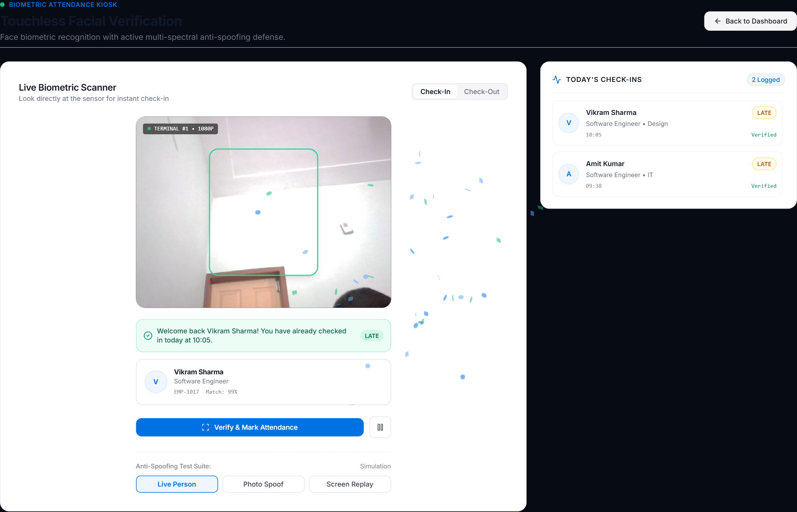
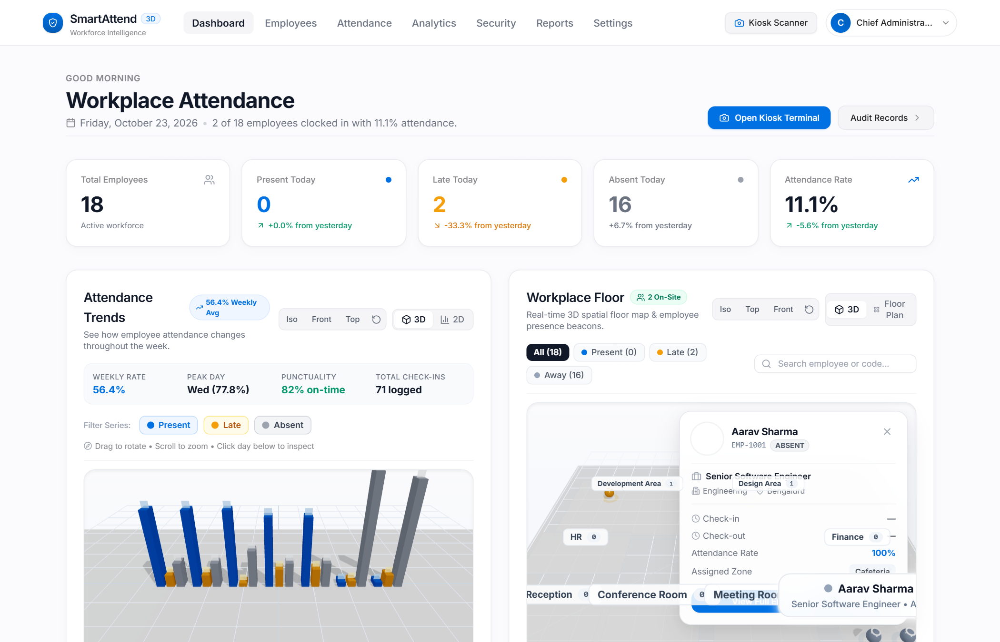
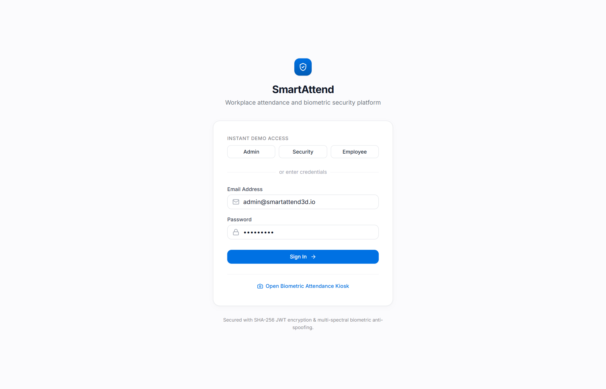
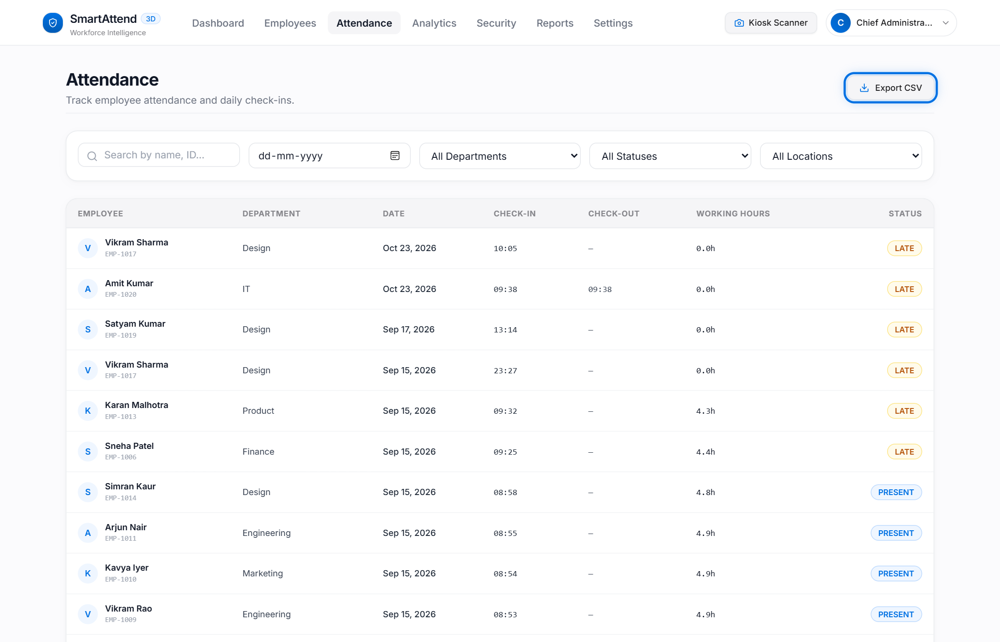

# Smart Attendance using Face Recognition and Anti-Spoofing (SmartAttend 3D)

> **Enterprise-grade workplace biometric attendance, multi-spectral anti-spoofing firewall, and real-time interactive 3D command center.**

[](https://react.dev)
[](https://threejs.org)
[](https://flask.palletsprojects.com)
[](https://opencv.org)
[](https://github.com/AmitKumar12490/Smart-Attendance-using-Face-Recognition-and-Anti-Spoofing-)

---

## 📸 Visual Overview

| Biometric Scanner HUD | Interactive 3D Floor Map |
| :---: | :---: |
|  |  |

| Auth Portal | Attendance Records & CSV Export |
| :---: | :---: |
|  |  |

---

## 🛡️ Key Features

### 1. 🤖 AI Biometrics & Multi-Cue Anti-Spoofing
- **Face Localization & Alignment**: OpenCV Haar / DNN SSD detector with Adaptive CLAHE equalization and eye orientation verification.
- **Deep Feature Embedding**: Generates L2-normalized 128-dimensional biometric vectors with cosine distance matching.
- **Multi-Spectral Liveness Firewall**:
  - **Fourier High-Frequency Spectrum**: Detects digital screen Moiré interference and pixel grid harmonics.
  - **Color Texture Descriptors (YCrCb / HSV)**: Distinguishes genuine human subcutaneous blood flow from flat paper prints and color laser toner.
  - **Laplacian Edge & Sharpness Distribution**: Flags synthetic blur and high-frequency halftone dot printing.
- **Presentation Attack Defense**: Identifies and blocks printed photos, tablet/mobile screen replays, and video loops.

### 2. 🌐 Interactive 3D Command Visualizations (Three.js & React Three Fiber)
- **3D Hero Security Shield**: Floating cybernetic shield with metallic wireframe shaders, orbital particles, and dynamic posture.
- **3D Workplace Floor Map**: Real-time isometric office floor layout with interactive employee status beacons (**Green**: Present, **Amber**: Late, **Rose**: Absent).
- **3D Analytics Trend Visualizer**: Dynamic 3D interactive bar visualization with orbit controls, lighting effects, and multi-axis inspection.
- **3D Quantum Brand Emblem**: Futuristic rotating shield logo embedded in the auth portal and navigation bar.

### 3. 🏢 Enterprise Attendance & Workplace Governance
- **Automated Check-In / Check-Out**: Enforces 1 check-in per day per employee with live shift duration tally.
- **Punctuality Intelligence**: Calculates late arrivals based on configurable department shift start time + grace period (e.g. 09:00 AM + 15 min).
- **Zero-Trust Incident Auditing**: Instantly logs security events with severity badges, confidence score, attack vectors, and terminal metadata.
- **Audit Reports & Exports**: Generates printable PDF statements and CSV exports.
- **Dual Role Access Control**: Full Admin Management Console and dedicated Employee Self-Service Dashboard.

---

## 📂 Architecture & Directory Structure

```text
Project/
├── backend/
│   ├── app/
│   │   ├── ai/
│   │   │   ├── face_detection.py      # OpenCV Haar & SSD DNN face localization
│   │   │   ├── face_embedding.py      # 128D normalized biometric descriptor generator
│   │   │   ├── face_recognition.py    # Database cosine similarity matching engine
│   │   │   ├── anti_spoofing.py       # Multi-cue Fourier + LBP + CNN liveness firewall
│   │   │   └── train_spoof_model.py   # Training script template for custom anti-spoof models
│   │   ├── models/
│   │   ├── routes/                    # REST API endpoints (Auth, Employee, Attendance, Analytics, Security, Reports, Settings)
│   │   ├── services/                  # Business logic (Auth, Workforce, Biometrics, Security)
│   │   ├── utils/                     # SQLite database manager, JWT security, 30-day demo seed data
│   │   └── config.py
│   ├── app.py                         # Flask server entrypoint (Port 5000)
│   ├── requirements.txt
│   └── .env.example
├── frontend/
│   ├── src/
│   │   ├── components/
│   │   │   ├── 3d/                    # 3D Shield, 3D Floor Map, 3D Trend Chart, 3D Logo
│   │   │   ├── attendance/            # WebRTC Camera Scanner HUD & Audio Chime Synth
│   │   │   ├── common/                # Logo, Navbar, Sidebar, StatCards, Badges, Modals
│   │   │   └── employee/              # Employee Modal, Face Capture, ID Badge Card
│   │   ├── pages/                     # Login, Dashboard, Employees, Mark Attendance, Records, Analytics, Security, Reports, Settings, My Portal
│   │   ├── context/                   # JWT AuthContext with Role-Based Access Control
│   │   ├── services/api.js            # Axios client with interceptors
│   │   └── index.css                  # Dark Cybernetic Glassmorphic Design System
│   ├── package.json
│   └── vite.config.js
├── database/
│   └── schema.sql                     # SQLite / PostgreSQL-ready relational database schema
└── README.md
```

---

## 🚀 Quick Start Guide

### Prerequisites
- **Node.js** (v18+)
- **Python** (3.9+)
- **Webcam** (optional for live browser camera scanner; simulation mode is built-in)

### Step 1: Start Backend (Flask API)
```bash
cd backend
python -m pip install -r requirements.txt
python app.py
```
> The backend will automatically initialize `smartattend.db` and populate realistic enterprise seed data (12 employees, 30 days of attendance logs, departments, and security events).  
> **API URL:** `http://127.0.0.1:5000`

### Step 2: Start Frontend (React + Vite)
```bash
cd frontend
npm install
npm run dev
```
> **Web App URL:** `http://localhost:5173`

---

## 🔑 Demo Login Credentials

| Role | Email | Password | Access Level |
| :--- | :--- | :--- | :--- |
| **Chief Administrator** | `admin@smartattend3d.io` | `Admin@123` | Full Admin Console, 3D Command, Settings & AI Config |
| **Security Officer** | `security@smartattend3d.io` | `Security@123` | Incident Resolution, Security Threat Center, Attendance |
| **Enrolled Employee** | `alex.vance@smartattend3d.io` | `Employee@123` | Personal Attendance Log, Working Hours, Digital ID Card |

*(1-Click demo fill buttons are also available on the login page for instant testing)*

---

## 🧠 AI Anti-Spoofing Model Training Pipeline

To train or fine-tune a custom deep learning model on datasets like CASIA-FASD or CelebA-Spoof:

1. Navigate to `backend/app/ai/train_spoof_model.py`.
2. Prepare your dataset in `dataset/real` and `dataset/spoof` folders.
3. Run the training script:
   ```bash
   python backend/app/ai/train_spoof_model.py --dataset_dir ./dataset --epochs 30 --batch_size 32
   ```
4. Place exported weights (`anti_spoof_weights.pt` or `.onnx`) into `backend/app/ai/weights/`.

---

## 📡 REST API Reference

| Method | Endpoint | Description |
| :--- | :--- | :--- |
| `POST` | `/api/auth/login` | JWT Authentication & role verification |
| `POST` | `/api/auth/register` | Register new user account |
| `GET` | `/api/employees` | Retrieve workforce list with search & department filters |
| `POST` | `/api/employees` | Enroll new employee with face biometrics |
| `POST` | `/api/face/detect` | OpenCV face coordinate & sharpness detection |
| `POST` | `/api/face/liveness` | Multi-cue Fourier & texture anti-spoof analysis |
| `POST` | `/api/attendance/mark` | Full biometric verification & check-in/out engine |
| `GET` | `/api/attendance/today` | Today's workplace attendance activity |
| `GET` | `/api/analytics/summary` | KPI aggregates (Present, Late, Absent, Spoofs) |
| `GET` | `/api/analytics/workplace-3d-nodes` | 3D spatial node coordinates for workplace floor |
| `GET` | `/api/security/events` | Anti-spoofing security incident audit trail |
| `GET` | `/api/reports/export-csv` | Download attendance spreadsheet |

---

## 📜 License & Acknowledgments
Built with ❤️ for advanced enterprise workplace security, final-year engineering exhibitions, and high-security biometric deployments.
