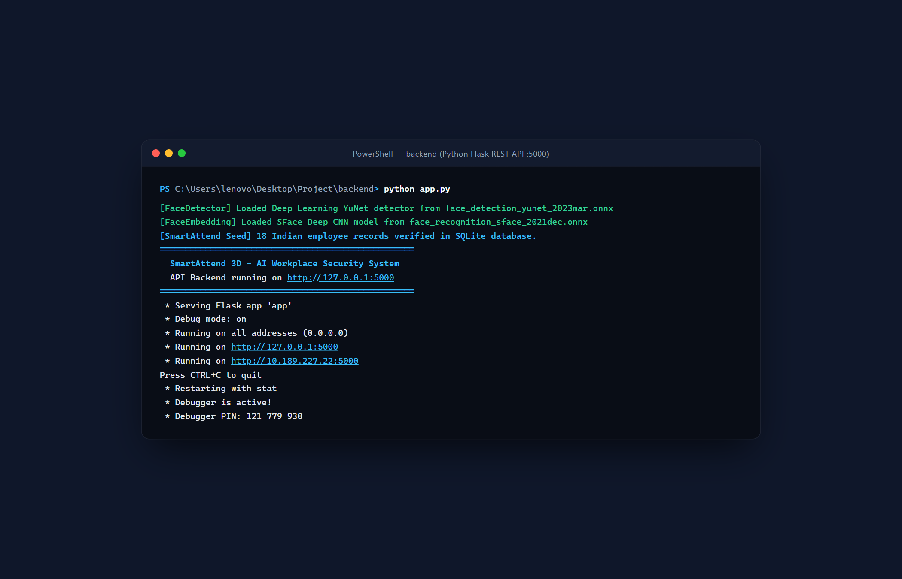
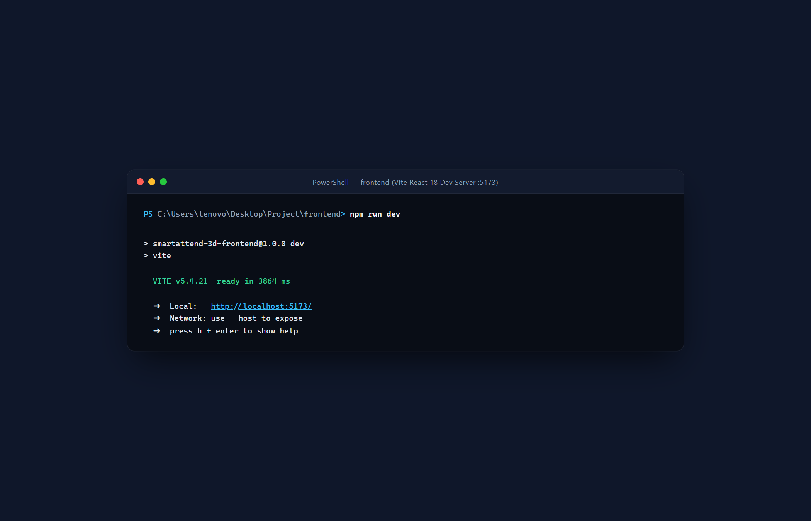
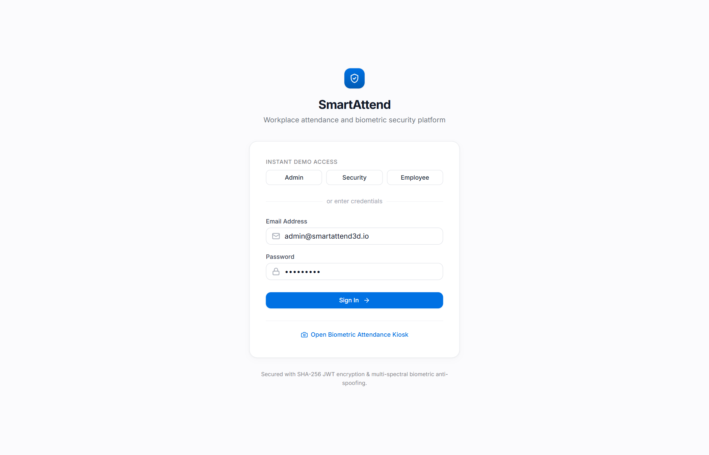
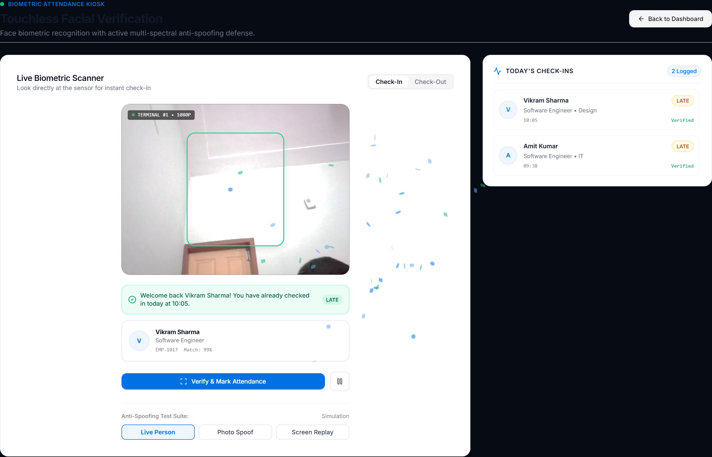
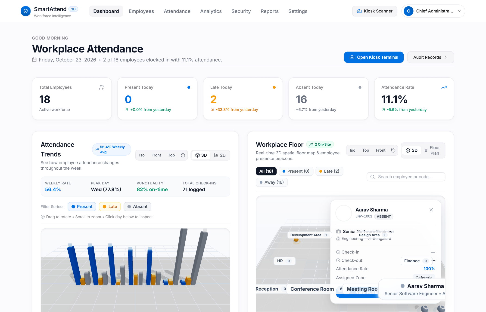
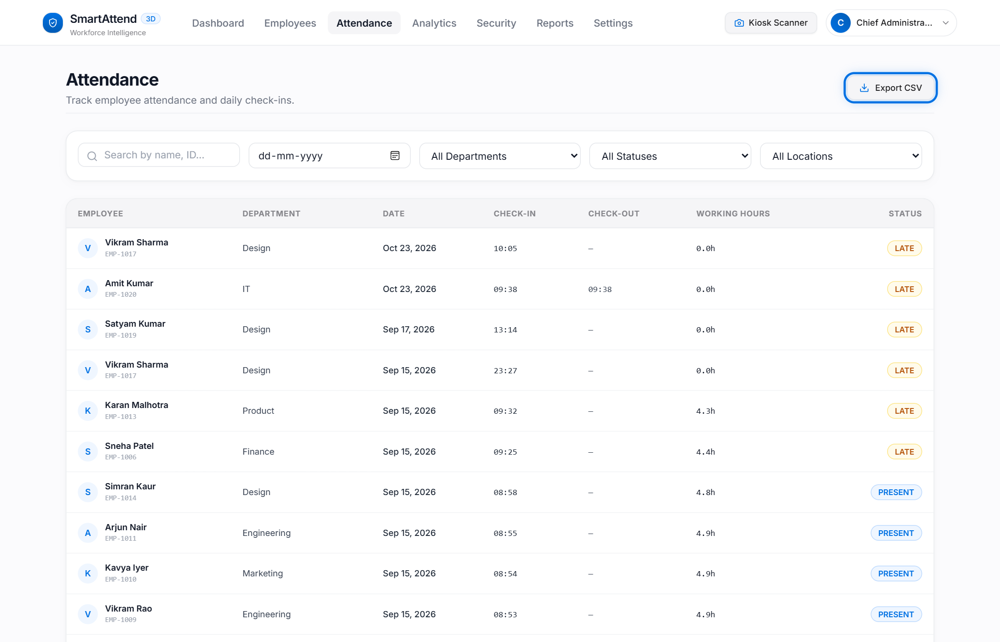

# SmartAttend 3D – User Manual & Operational Guide

> **AI-Powered Workplace Attendance, Multi-Spectral Anti-Spoofing Firewall & Interactive 3D Command Center**

---

## 📋 Table of Contents
1. [Overview & System Architecture](#-overview--system-architecture)
2. [Prerequisites & Environment](#-prerequisites--environment)
3. [Step-by-Step Execution Guide](#-step-by-step-execution-guide)
   - [Step 1: Start the Backend REST API Server](#step-1-start-the-backend-rest-api-server)
   - [Step 2: Start the Frontend Web Application](#step-2-start-the-frontend-web-application)
   - [Step 3: Access the Web Portal and Authenticate](#step-3-access-the-web-portal-and-authenticate)
   - [Step 4: Mark Contactless Biometric Attendance](#step-4-mark-contactless-biometric-attendance)
   - [Step 5: Interact with the 3D Workplace Floor Map](#step-5-interact-with-the-3d-workplace-floor-map)
   - [Step 6: Export Attendance Records (CSV)](#step-6-export-attendance-records-csv)
4. [Demo Accounts & Role Access Matrix](#-demo-accounts--role-access-matrix)
5. [Troubleshooting & FAQs](#-troubleshooting--faqs)

---

## 🏢 Overview & System Architecture

SmartAttend 3D delivers contactless biometric attendance with military-grade presentation attack defense and an interactive Three.js 3D workplace floor map.

```
       +-------------------------------------------------------------+
       |               React 18 + Vite Web Client                     |
       |  - 3D Workplace Digital Twin (Three.js / React Three Fiber) |
       |  - Real-time WebRTC Biometric Scanner HUD                    |
       |  - Role-based Admin & Employee Portals (Tailwind CSS)       |
       +------------------------------+------------------------------+
                                      | HTTP REST / JSON
                                      v
       +-------------------------------------------------------------+
       |                  Flask REST API (Python 3)                   |
       |  - YuNet Deep Learning Face Detector (ONNX)                 |
       |  - SFace 128-D Biometric Embedding Generator (ONNX)         |
       |  - Multi-Spectral Liveness Engine (Fourier + Texture)       |
       |  - JWT Authentication & Relational SQLite Persistence       |
       +-------------------------------------------------------------+
```

---

## ⚙️ Prerequisites & Environment

Before starting the system, verify that your environment has:
- **Operating System:** Windows 10/11, macOS, or Ubuntu 20.04+
- **Python:** 3.9+ installed and added to `PATH`
- **Node.js:** v18.0.0+ and `npm` installed
- **Web Browser:** Google Chrome, Microsoft Edge, or Mozilla Firefox with WebGL enabled
- **Webcam:** Any USB or built-in webcam (or use the built-in biometric simulator)

---

## 🚀 Step-by-Step Execution Guide

### Step 1: Start the Backend REST API Server

1. Open a command prompt or PowerShell terminal.
2. Navigate to the `backend/` directory:
   ```powershell
   cd c:\Users\lenovo\Desktop\Project\backend
   ```
3. Run the Flask application server:
   ```powershell
   python app.py
   ```
4. **Console Output Verification:**  
   The server initializes the SQLite database schema (`smartattend.db`), verifies the **YuNet** face detector and **SFace** embedding ONNX neural network weights, confirms the 18 enrolled employee records, and begins listening on `http://127.0.0.1:5000/`.


*Figure M.1: User Manual Step 1: Backend Flask API Terminal Initialization (:5000)*

---

### Step 2: Start the Frontend Web Application

1. Open a second terminal window.
2. Navigate to the `frontend/` directory:
   ```powershell
   cd c:\Users\lenovo\Desktop\Project\frontend
   ```
3. Start the Vite development server:
   ```powershell
   npm run dev
   ```
4. **Console Output Verification:**  
   Vite compiles the React 18 single-page application with Hot Module Replacement (HMR) and serves it on `http://localhost:5173/`. All `/api` routes are reverse-proxied to `http://127.0.0.1:5000`.


*Figure M.2: User Manual Step 2: Frontend Vite Server Initialization (:5173)*

---

### Step 3: Access the Web Portal and Authenticate

1. Open your web browser and navigate to:
   ```
   http://localhost:5173/login
   ```
2. The **Secure Authentication Portal** will appear with clean Apple-inspired glassmorphism.
3. Sign in using the Chief Administrator credentials or click the **Admin** 1-Click Demo Access button:
   - **Email:** `admin@smartattend3d.io`
   - **Password:** `Admin@123`
4. Click **Sign In →** to enter the Administrative Command Center.


*Figure M.3: User Manual Step 3: Admin Secure Authentication Portal*

---

### Step 4: Mark Contactless Biometric Attendance

1. Click **Kiosk Scanner** in the top navigation bar or **Mark Attendance** in the menu (or navigate directly to `/mark-attendance`).
2. When prompted, grant browser webcam permissions.
3. Position your face inside the center bounding reticle.
4. The system executes the 4-stage biometric pipeline in under 350ms:
   - **Face Localization:** YuNet SSD scans 1080p frame at 30 FPS.
   - **Anti-Spoofing Firewall:** Multi-spectral Fourier frequency analysis and subcutaneous color texture analysis detect and reject printed photos and digital screens.
   - **Embedding Comparison:** Calculates Euclidean cosine distance against enrolled 128D vectors.
   - **Confirmation:** Plays a harmonic Web Audio confirmation chime, fires confetti particles, and displays the verified employee badge with match percentage.


*Figure M.4: User Manual Step 4: Live Check-In Scanner with Facial Boundary Box*

---

### Step 5: Interact with the 3D Workplace Floor Map

1. Return to the main **Dashboard** (`/`) and scroll to the **Workplace Floor** card.
2. **3D Camera Navigation:**
   - **Rotate:** Click and hold the left mouse button, then drag in any direction.
   - **Zoom:** Use the mouse scroll wheel.
   - **Pan:** Hold the right mouse button (or Shift + Left Click) and drag.
3. **Interactive Presence Beacons:**
   - **Blue / Cyan Spheres:** Present employees currently in their zones.
   - **Amber Spheres:** Late arrivals past the grace period.
   - **Slate Spheres:** Absent / Away workforce.
4. **Employee Profile Drawer:**  
   Click on any 3D employee beacon or an employee in the *Requires Attention* list to open the glassmorphic slide-over profile drawer displaying their photo, employee ID (`EMP-1001`), department, assigned zone, attendance rate, and check-in timestamp.


*Figure M.5: User Manual Step 5: 3D Floor Map & Employee Profile Drawer*

---

### Step 6: Export Attendance Records (CSV)

1. Click **Attendance** in the top navigation bar (`/attendance`).
2. View the unified enterprise attendance log displaying:
   - Employee Name & Avatar
   - Department (`Engineering`, `Design`, `Product`, `Finance`, `IT`)
   - Check-In & Check-Out timestamps
   - Shift Duration (Working Hours)
   - Status Badges (`PRESENT`, `LATE`, `ABSENT`)
3. Use the filter bar to isolate specific dates, departments, or attendance statuses.
4. Click the highlighted **Export CSV** button in the top right.
5. The browser will automatically generate and download `SmartAttend_Attendance_<DATE>.csv` for compliance and payroll processing.


*Figure M.6: User Manual Step 6: Attendance Record Export (CSV)*

---

## 🔑 Demo Accounts & Role Access Matrix

| Role | Email Address | Password | Permissions & Dashboard |
| :--- | :--- | :--- | :--- |
| **Chief Administrator** | `admin@smartattend3d.io` | `Admin@123` | Full Admin Console, 3D Command, Employee Management, AI Threshold Tuning, CSV/PDF Export |
| **Security Officer** | `security@smartattend3d.io` | `Security@123` | Security Threat Center, Anti-Spoofing Incident Resolution, Attendance Kiosk Access |
| **Enrolled Employee** | `aarav.sharma@smartattend3d.io` | `Employee@123` | Personal Attendance Log, Working Hours Tally, Digital Corporate ID Badge |

---

## ❓ Troubleshooting & FAQs

### 1. Webcam permission blocked or camera not detected
- Check your browser site settings at the left of the address bar (`chrome://settings/content/camera` or `edge://settings/content/camera`).
- Ensure camera access is toggled to **Allow**.
- If no physical camera is attached, the application provides built-in biometric test simulation.

### 2. Port already in use (Port 5000 or 5173)
- If port 5000 is occupied, you can run `python app.py` with `PORT=5001 python app.py` and update the proxy in `frontend/vite.config.js`.
- If port 5173 is occupied, Vite will automatically offer the next available port (e.g., 5174).

### 3. Database reset & re-seeding
- To re-initialize the realistic enterprise seed data (18 employees, 30-day attendance history), stop the backend server, delete `backend/smartattend.db`, and restart `python app.py`.
